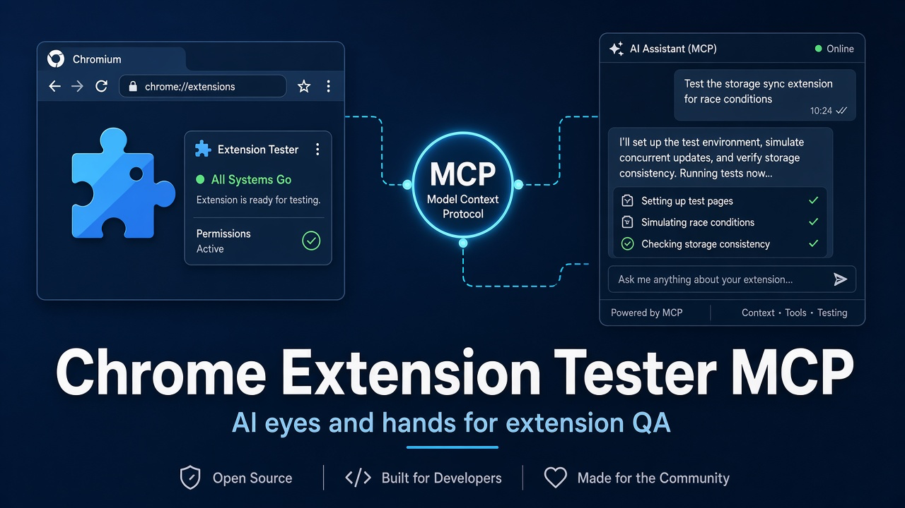
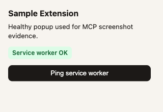
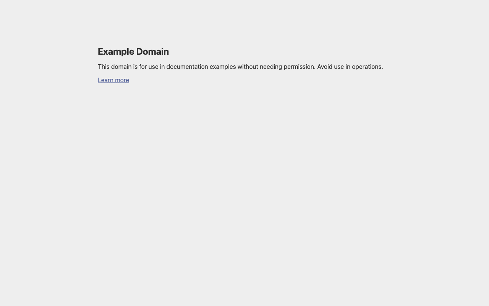

<p align="center">
  
</p>

<p align="center">
  <a href="https://opensource.org/licenses/MIT"></a>
  <a href="https://github.com/heyitschien/chrome-extension-tester-mcp/releases/tag/v1.0.0"></a>
  <a href="https://github.com/heyitschien/chrome-extension-tester-mcp/actions"></a>
  <a href="https://modelcontextprotocol.io"></a>
</p>

<h1 align="center">Chrome Extension Tester MCP</h1>

<p align="center">
  <strong>Give your AI assistant eyes and hands for Chrome extension work.</strong><br />
  An MCP server that launches real Chromium with your unpacked extension, takes screenshots, clicks UI, and returns console logs — so the assistant can verify changes instead of asking you to click around.
</p>

<p align="center">
  <a href="#what-we-built">What we built</a> ·
  <a href="#-quick-start">Quick Start</a> ·
  <a href="#-ide-setup">IDE Setup</a> ·
  <a href="#-tools">Tools</a> ·
  <a href="#-see-it-in-action">Screenshots</a> ·
  <a href="docs/SUPPORT-USE-CASE.md">Support walkthrough</a> ·
  <a href="CONTRIBUTING.md">Contributing</a>
</p>

---

## What we built

This is a **Model Context Protocol (MCP) server** for **AI-assisted Chrome extension development and debugging**.

When you build extensions with Cursor, Claude Desktop, or similar assistants, every change usually means a manual loop: reload the extension, open the popup, click around, screenshot, paste back into chat. This server closes that loop.

| Layer | What it is |
| --- | --- |
| **Protocol** | MCP over stdio (tools the assistant can call) |
| **Browser** | Headful Chromium via [Playwright](https://playwright.dev/) |
| **Target** | Your **unpacked** extension folder (must contain `manifest.json`) |
| **Loop** | `launch_browser` → screenshot / click / logs → `close_browser` |

**Built for:** extension authors and support/QA folks who want structured repros with visual + console evidence.

**Not:** an enterprise test cloud, a full Playwright Test suite replacement, or a Chrome Web Store publishing tool.

---

## Why it exists

1. Open `chrome://extensions` → **Reload**
2. Re-open the popup or side panel
3. Click around to see if it works
4. Screenshot, paste into chat, describe the bug

That loop is slow for humans and worse for AI agents. This MCP server lets the assistant drive a real browser session against your local extension build.

<p align="center">
  
</p>

---

## Features (what the code actually does)

| Capability | Detail |
| --- | --- |
| **Load unpacked extensions** | Chromium with `--load-extension` / `--disable-extensions-except` (MV2 or MV3 folders that include `manifest.json`) |
| **Headful browser** | Visible Chromium window (not headless) |
| **Screenshots** | Saves the **active page viewport** into your workspace |
| **Clicks** | CSS selector clicks on the active page |
| **Console capture** | Collects page `console` messages since launch |
| **Default path** | Optional `CHROME_EXTENSION_PATH` so you need not pass the path every time |

### Honest limits

- One browser session at a time (re-launch replaces the previous session).
- Screenshots/clicks target the **active tab**, not a dedicated “open toolbar popup” API.
- No built-in tools for storage, network HAR, badges, messaging, or assertions beyond what you get from screenshots + console + clicks.
- You bring a **built** extension folder (e.g. `dist/` or a fixture under `fixtures/`).

---

## Tools

Five MCP tools — matching [`src/index.ts`](src/index.ts):

| Tool | Description |
| --- | --- |
| `launch_browser` | Start Chromium with your extension; optional `url`, `width`, `height` |
| `take_extension_screenshot` | Capture the active view to a workspace file |
| `click_element` | Click by CSS selector (optional `timeout`) |
| `get_browser_logs` | Return captured console output since launch |
| `close_browser` | End the session cleanly |

---

## See it in action

Real captures from the demo fixtures (regenerate with `npm run capture-evidence`):

<p align="center">
  
  &nbsp;&nbsp;
  
</p>
<p align="center"><em>Left: healthy sample popup · Right: intentional blank-popup repro (synthetic)</em></p>

<p align="center">
  
</p>
<p align="center"><em>Browser session after <code>launch_browser</code> + navigate — used for visual verification</em></p>

More context: [docs/SUPPORT-USE-CASE.md](docs/SUPPORT-USE-CASE.md) · [docs/screenshots/](docs/screenshots/) · [docs/evidence/](docs/evidence/) · [fixtures/](fixtures/)

---

## Quick Start

### Prerequisites

- **Node.js 18+**
- A **built** extension folder containing `manifest.json`

### Install from this repository

The GitHub release is the source of truth for **this** project. Clone, build, then point your MCP client at the built CLI:

```bash
git clone https://github.com/heyitschien/chrome-extension-tester-mcp.git
cd chrome-extension-tester-mcp
npm install
npm run build
```

Optional default extension path:

```bash
export CHROME_EXTENSION_PATH="/absolute/path/to/your/extension/dist"
```

> **Note on npm:** the unscoped name `chrome-extension-tester-mcp` on the public npm registry currently resolves to a **different** project (not this repo). Do **not** use `npx chrome-extension-tester-mcp` expecting this server. Prefer the clone + `node dist/index.js` flow below.

---

## IDE Setup

### Cursor (recommended)

1. Build this repo (`npm install && npm run build`).
2. Open **Cursor Settings** → **MCP**.
3. Add a server that runs the local build:

```json
{
  "mcpServers": {
    "chrome-extension-tester": {
      "command": "node",
      "args": ["/absolute/path/to/chrome-extension-tester-mcp/dist/index.js"],
      "env": {
        "CHROME_EXTENSION_PATH": "/absolute/path/to/your/extension/dist"
      }
    }
  }
}
```

Ready-made copy: [`examples/cursor-mcp.json`](examples/cursor-mcp.json).

<details>
<summary><strong>Claude Desktop</strong></summary>

Add to `~/Library/Application Support/Claude/claude_desktop_config.json` (macOS) or the equivalent on your OS — same shape as above (`command`: `node`, `args`: path to `dist/index.js`).

See [`examples/claude-desktop-mcp.json`](examples/claude-desktop-mcp.json).

</details>

<details>
<summary><strong>VS Code (Cline, Roo Code, etc.)</strong></summary>

Same local `node` + `dist/index.js` pattern. See [`examples/vscode-mcp.json`](examples/vscode-mcp.json).

</details>

---

## Example agent workflow

After the MCP server is connected:

```text
1. launch_browser              → extensionPath: "dist", url: "https://example.com"
2. take_extension_screenshot   → filename: "docs/screenshots/check.png"
3. get_browser_logs            → inspect errors
4. click_element               → selector: "#open-popup"
5. close_browser               → when done
```

Try the included fixtures without building your own extension:

```text
launch_browser → extensionPath: "fixtures/sample-extension-working"
```

---

## For AI agents

**Visual changes (CSS, layout, popup HTML)**

1. Apply code changes and build the extension.
2. Call `launch_browser` with `extensionPath` pointing at the build output (e.g. `dist/`).
3. Navigate or open the UI you care about (page URL or `chrome-extension://…` paths as needed).
4. Call `take_extension_screenshot` under `docs/screenshots/`.
5. Inspect the image; iterate.

**Runtime errors**

1. Reproduce in the launched browser.
2. Call `get_browser_logs` and look for CSP violations, MV3 service worker errors, or message-passing failures.

**Always** call `close_browser` when finished.

---

## Development (from source)

```bash
git clone https://github.com/heyitschien/chrome-extension-tester-mcp.git
cd chrome-extension-tester-mcp
npm install
npm run build
node dist/index.js
```

Regenerate screenshot + console evidence:

```bash
npm run capture-evidence
```

---

## Scope

| In scope | Out of scope |
| --- | --- |
| MCP server source, examples, fixtures, CI | Private employer / customer extension code |
| Local testing of **your** unpacked builds | Claims of production QA-org adoption |
| Support-style repro docs with synthetic fixtures | Credentials or real customer ticket data |

For interview / portfolio context, see [docs/recruiter-notes.md](docs/recruiter-notes.md).

---

## Legal

- Licensed under the [MIT License](LICENSE).
- Uses [Playwright](https://playwright.dev/) (Apache 2.0) for browser automation.
- Chromium is downloaded by Playwright on first run; see [Playwright’s license terms](https://github.com/microsoft/playwright/blob/main/LICENSE).

---

## Contributing

Issues and PRs welcome — read [CONTRIBUTING.md](CONTRIBUTING.md) and the [Code of Conduct](CODE_OF_CONDUCT.md).

Security issues: [SECURITY.md](SECURITY.md) — please do **not** open a public issue.

---

## Author

**[@heyitschien](https://github.com/heyitschien)**

<p align="center">
  <sub>Built so AI assistants can verify Chrome extensions in a real browser — not guess from your screenshots.</sub>
</p>
